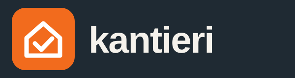

# SiteTrail — Brand book v1

## Name
**SiteTrail.** In English, a "paper trail" is written proof of what happened. SiteTrail is the trail of every day on site: every photo, every voice note and every approved change in one record you can show when there's a dispute.

**Why an English name:** it's neutral. Albanian and Macedonian speakers understand it equally, and neither feels it's "not for them". Earlier options were dropped for that reason: *Kantieri* isn't the word Kosovo builders use (they say "teren" or "punishte") and means nothing in Macedonian, and invented names like *Sitero* sounded generic.

| Check | Result (14 Nov 2026) |
|---|---|
| sitetrail.com | ❌ Taken |
| **sitetrail.app** | ✅ Looks free (no DNS record). Register it to confirm |
| Instagram **@sitetrail.app** | ⚠️ Check by hand on instagram.com/sitetrail.app (backup: @sitetrail.ks) |

## Tagline
- **Albanian:** *Çdo ditë në teren, e dokumentuar.*
- **English:** *Every day on site, on the record.*
- **For sales:** *Klienti aprovon, ti ke provën.* ("The client approves, you have the proof.")

## Logo
Two dots leading into a check mark: the **trail** of days on site that ends in **approved**. It sits on an orange rounded square, so it works as a phone app icon. In the wordmark, "Site" is in the text colour and "Trail" is in orange.

| On light | On dark | Icon only |
|---|---|---|
|  |  |  |

Files: [`brand/logo-light.svg`](brand/logo-light.svg), [`brand/logo-dark.svg`](brand/logo-dark.svg), [`brand/logo-icon.svg`](brand/logo-icon.svg).

**Rules:** keep space around the logo at least as wide as the check mark. Don't stretch it, recolour the icon or put it on a busy photo.

## Colours

| Colour | Hex | Use |
|---|---|---|
| **Safety Orange** | `#F26B1D` | Logo, main buttons, "approve" actions. The colour of site safety vests |
| **Concrete Slate** | `#1F2A33` | Text, dark backgrounds, headers |
| **Plaster White** | `#F5F2EC` | Light backgrounds, cards |

Orange is for actions only, never for long text.

## Fonts
- **Space Grotesk** (Bold 700): headings and the logo. Solid and technical, like a drawing title block. [Google Fonts](https://fonts.google.com/specimen/Space+Grotesk)
- **Inter** (Regular 400 / Semibold 600): all body text and the app interface. Very readable on small phone screens and supports Albanian (ë, ç) and Macedonian Cyrillic. [Google Fonts](https://fonts.google.com/specimen/Inter)

## Tone of voice: **Direct · Practical · Trustworthy**
We talk like a good site engineer: short sentences, no fancy words, always about the work. In the app we use the words builders use: **"teren"**, not "kantier".

- ✅ **Sounds like us:** "Record today in two minutes. Your client approves the change, and you have proof."
- ❌ **Doesn't sound like us:** "Unlock synergies with our revolutionary AI-powered digital transformation platform for the construction ecosystem!"
