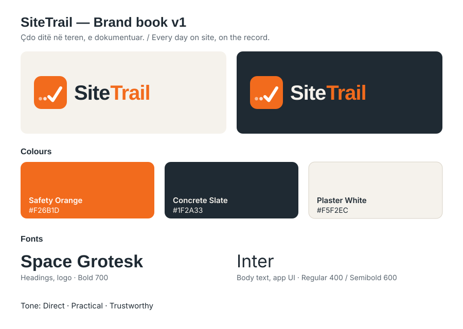

# SnapInvoice — Brand book v1

## Name
**SnapInvoice** = **Snap** (take a quick photo) + **Invoice**.

- It says exactly what the product does: **take a photo of the invoice, and the data is ready.**
- It's in simple English, so it's neutral in every country and easy for accountants and business owners to remember.

| Check | Result (15 Nov 2026) |
|---|---|
| snapinvoice.com | ❌ Taken |
| **snapinvoice.app** | ✅ Looks free (no DNS record). Register it to confirm |
| Instagram **@snapinvoice.app** | ⚠️ Check by hand on instagram.com/snapinvoice.app |

## Tagline
- **Main:** *Snap the invoice. Skip the typing.*
- **For accountants (sales):** *Stop typing invoices. Just check them.*

## Logo
A white invoice inside the four corners of a camera viewfinder: **the invoice being "snapped"**. It sits on a green rounded square, so it works as a phone icon. In the wordmark, "Snap" is in the text colour and "Invoice" is in green.

| On light | On dark | Icon only |
|---|---|---|
|  |  |  |

Files: [`brand/logo-light.svg`](brand/logo-light.svg), [`brand/logo-dark.svg`](brand/logo-dark.svg), [`brand/logo-icon.svg`](brand/logo-icon.svg).

**Rules:** keep space around the logo at least as wide as one viewfinder corner. Don't stretch it, recolour the icon or put it on a busy photo. On dark backgrounds, "Invoice" uses the lighter green `#3FBF8F` so it stays readable.

## Colours

| Colour | Hex | Use |
|---|---|---|
| **Ledger Green** | `#12805C` | Logo, main buttons, "approved" status. Green = correct, balanced, money in order |
| **Ink Navy** | `#14213D` | Text, numbers, dark backgrounds |
| **Paper White** | `#F7F5F0` | Backgrounds, cards, like a clean sheet of paper |

In the app, fields the AI isn't sure about use a warning orange, which is a functional colour, not a brand colour.

## Fonts
- **Space Grotesk** (Bold 700): headings and the logo. Modern and a little technical, which suits AI. [Google Fonts](https://fonts.google.com/specimen/Space+Grotesk)
- **Inter** (Regular 400 / Semibold 600): all body text, tables and **numbers**. Its tabular numbers line up in columns, which matters for accountants. It also supports Latin and Cyrillic characters, so supplier names on invoices display correctly. [Google Fonts](https://fonts.google.com/specimen/Inter)

## Tone of voice: **Clear · Precise · Calm**
We talk like a good accountant: exact, no exaggeration, and calm even at deadline time. We never promise "100% automatic". We say the AI does the typing and the accountant stays in control.

- ✅ **Sounds like us:** "Your clients send photos. You get the numbers typed. You check them and export. Done before the deadline."
- ❌ **Doesn't sound like us:** "🚀 Revolutionary AI that replaces your accountant and does your taxes 100% automatically!!!"
