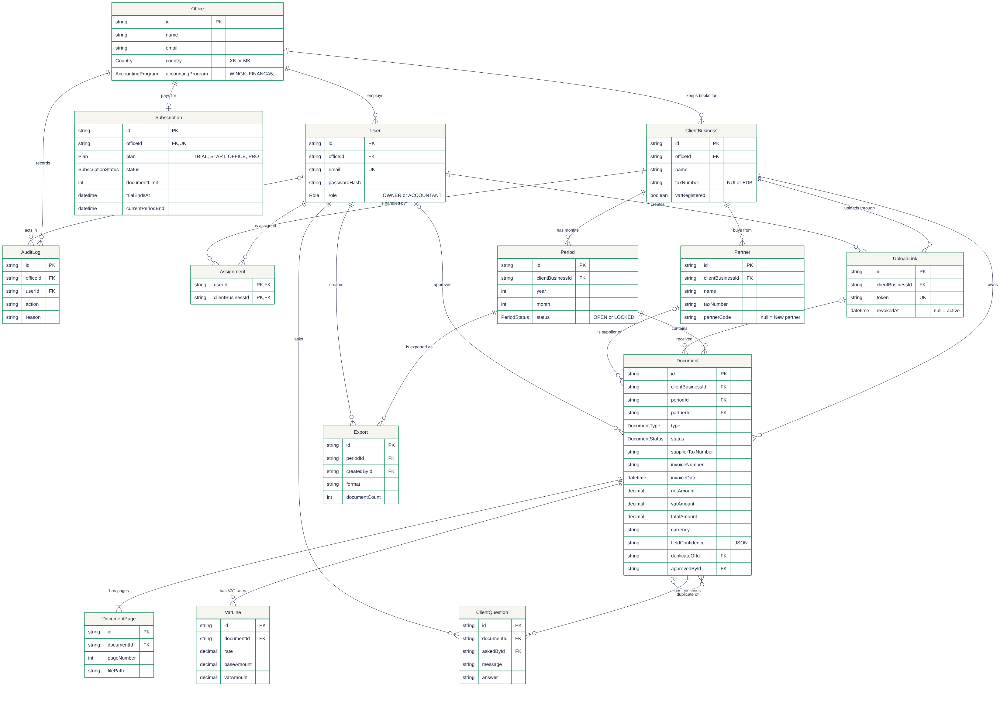

# SnapInvoice: Data model

The things SnapInvoice stores, taken from the roles, flows and business rules in [rules-and-flows.md](rules-and-flows.md).
The code version is [`api/prisma/schema.prisma`](../api/prisma/schema.prisma), and the first migration that creates the tables is in [`api/prisma/migrations/`](../api/prisma/migrations/).



## The models in plain words

| Model | What it is | Links to | Rules it supports |
|---|---|---|---|
| **Office** | The accounting office: the paying customer. Stores its country and accounting program (WinGK, Financa 5, ...) | has many Users, ClientBusinesses, AuditLogs; one Subscription | Program choice sets the export format (Flow 1) |
| **User** | A person who logs in: role **OWNER** or **ACCOUNTANT** | belongs to one Office | Roles table |
| **Subscription** | The office's plan (Trial, Start, Office, Pro), status, document limit, trial end | belongs to one Office | Rule 10 (count documents), rule 12 (cancel at end of month), trial in Flow 1 |
| **ClientBusiness** | The small business the office keeps books for. Tax number = NUI (Kosovo) or EDB (North Macedonia). It never logs in | belongs to one Office | Rule 7 |
| **Assignment** | Which accountant may work on which client business | links User ↔ ClientBusiness | "Accountant sees only clients assigned to them" |
| **UploadLink** | The personal upload link of a business (a secret token). `revokedAt` set = no longer works | belongs to one ClientBusiness | Rule 13 (reset link), Flow 2 |
| **Partner** | A supplier of a client business, with its **partner code** in the accounting program. No code = "New partner" | belongs to one ClientBusiness | Rule 8 |
| **Period** | One month of one business (year + month). **OPEN** or **LOCKED** | belongs to one ClientBusiness | Rule 1 (one month), rule 6 (locked after export) |
| **Document** | One invoice / receipt / credit note: the fields AI read (supplier, tax number, invoice number, date, net, VAT, total, currency), how sure the AI was per field, and its status | belongs to one ClientBusiness and one Period; optional Partner, UploadLink, approving User, and the Document it duplicates | Rules 1–5 |
| **DocumentPage** | The original photo or PDF of one page. Never changed | belongs to one Document | Rule 9, rule 10 (3 pages = 1 document) |
| **VatLine** | One VAT rate on a document (an invoice can have 18% and 5%) | belongs to one Document | Rule 4 (the maths must add up) |
| **ClientQuestion** | "Ask client": a question from the accountant about one document, and the business's answer | belongs to one Document; asked by a User | Flow 3, step 5 |
| **Export** | One exported file for one month, in the office's program format | belongs to one Period; made by a User | Flow 3, steps 6–7 |
| **AuditLog** | Who did what and why (month unlocked, link reset, ...) | belongs to one Office; optional User | Rule 6 (unlocks are logged), admin can't read data silently |

### Document status
`PROCESSING` → `NEEDS_REVIEW` → (`WAITING_FOR_CLIENT` →) `APPROVED`.
Side exits: `DUPLICATE` (same supplier tax number + invoice number + total already exists, rule 5) and `FAILED` (the AI could not read it).
Only `APPROVED` documents go into an export (rule 2).

### Choices I made
- **Money is stored as `Decimal`**, never as a floating-point number, so totals don't drift by a cent.
- **AI confidence per field** is stored as JSON in `Document.fieldConfidence` (e.g. `{"totalAmount": 0.62}`). A low value = an orange field (rule 3).
- **Partners belong to a client business**, not to the office, because in WinGK you choose the company first, so partner codes are kept per company (to confirm with the accountants).
- **No separate table for the "business client" role**: the business doesn't log in, it only has an UploadLink.
- **IDs are text (`cuid`)**, so upload links and URLs don't reveal how many documents exist.

## Same model for dbdiagram.io

To edit the picture on [dbdiagram.io](https://dbdiagram.io), paste this:

```dbml
Table Office {
  id varchar [pk]
  name varchar
  email varchar
  phone varchar
  country varchar [note: 'XK or MK']
  accountingProgram varchar [note: 'WINGK, FINANCA5, ALPHA, BILANC, OTHER_EXCEL']
  createdAt datetime
}

Table User {
  id varchar [pk]
  officeId varchar [ref: > Office.id]
  name varchar
  email varchar [unique]
  passwordHash varchar
  role varchar [note: 'OWNER or ACCOUNTANT']
  emailVerifiedAt datetime
  createdAt datetime
}

Table Subscription {
  id varchar [pk]
  officeId varchar [unique, ref: - Office.id]
  plan varchar [note: 'TRIAL, START, OFFICE, PRO']
  status varchar [note: 'TRIALING, ACTIVE, CANCELLED, EXPIRED']
  documentLimit int
  trialEndsAt datetime
  currentPeriodEnd datetime
  cancelledAt datetime
  createdAt datetime
}

Table ClientBusiness {
  id varchar [pk]
  officeId varchar [ref: > Office.id]
  name varchar
  taxNumber varchar [note: 'NUI or EDB']
  vatRegistered boolean
  contactPhone varchar
  contactEmail varchar
  createdAt datetime
  indexes { (officeId, taxNumber) [unique] }
}

Table Assignment {
  userId varchar [ref: > User.id]
  clientBusinessId varchar [ref: > ClientBusiness.id]
  createdAt datetime
  indexes { (userId, clientBusinessId) [pk] }
}

Table UploadLink {
  id varchar [pk]
  clientBusinessId varchar [ref: > ClientBusiness.id]
  token varchar [unique]
  createdById varchar [ref: > User.id]
  createdAt datetime
  revokedAt datetime [note: 'null = active']
}

Table Partner {
  id varchar [pk]
  clientBusinessId varchar [ref: > ClientBusiness.id]
  name varchar
  taxNumber varchar
  partnerCode varchar [note: 'null = New partner']
  createdAt datetime
  indexes { (clientBusinessId, taxNumber) [unique] }
}

Table Period {
  id varchar [pk]
  clientBusinessId varchar [ref: > ClientBusiness.id]
  year int
  month int
  status varchar [note: 'OPEN or LOCKED']
  lockedAt datetime
  indexes { (clientBusinessId, year, month) [unique] }
}

Table Document {
  id varchar [pk]
  clientBusinessId varchar [ref: > ClientBusiness.id]
  periodId varchar [ref: > Period.id]
  uploadLinkId varchar [ref: > UploadLink.id]
  partnerId varchar [ref: > Partner.id]
  type varchar [note: 'INVOICE, RECEIPT, CREDIT_NOTE, OTHER']
  status varchar [note: 'PROCESSING, NEEDS_REVIEW, WAITING_FOR_CLIENT, APPROVED, DUPLICATE, FAILED']
  supplierName varchar
  supplierTaxNumber varchar
  invoiceNumber varchar
  invoiceDate datetime
  netAmount decimal
  vatAmount decimal
  totalAmount decimal
  currency varchar
  fieldConfidence varchar [note: 'JSON']
  duplicateOfId varchar [ref: > Document.id]
  approvedById varchar [ref: > User.id]
  approvedAt datetime
  uploadedAt datetime
}

Table DocumentPage {
  id varchar [pk]
  documentId varchar [ref: > Document.id]
  pageNumber int
  filePath varchar
  mimeType varchar
  createdAt datetime
}

Table VatLine {
  id varchar [pk]
  documentId varchar [ref: > Document.id]
  rate decimal
  baseAmount decimal
  vatAmount decimal
}

Table ClientQuestion {
  id varchar [pk]
  documentId varchar [ref: > Document.id]
  askedById varchar [ref: > User.id]
  message varchar
  answer varchar
  createdAt datetime
  answeredAt datetime
}

Table Export {
  id varchar [pk]
  periodId varchar [ref: > Period.id]
  createdById varchar [ref: > User.id]
  format varchar
  filePath varchar
  documentCount int
  createdAt datetime
}

Table AuditLog {
  id varchar [pk]
  officeId varchar [ref: > Office.id]
  userId varchar [ref: > User.id]
  action varchar
  entityType varchar
  entityId varchar
  reason varchar
  createdAt datetime
}
```

## Changing the model
1. Edit `api/prisma/schema.prisma`.
2. Run `npm run db:migrate:new -w @snapinvoice/api -- --name what_changed`. This creates a new migration in `api/prisma/migrations/`.
3. Update this file and the picture.
